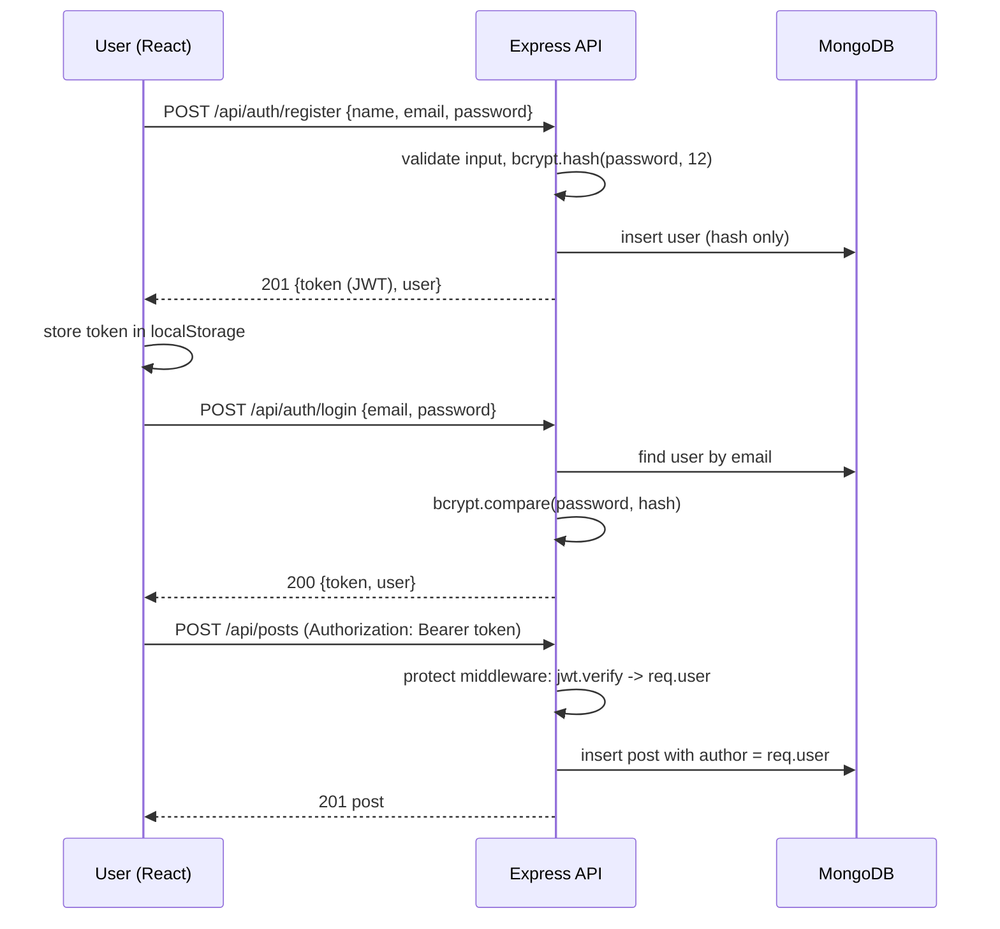

# Module 11 - Authentication flow

**Security measures:** bcrypt (cost 12) password hashing, JWT with expiry, `protect` and `adminOnly` middleware, ownership checks on posts, helmet headers, CORS allow-list, rate limiting on `/api/auth`, `password` field excluded from queries by default.
